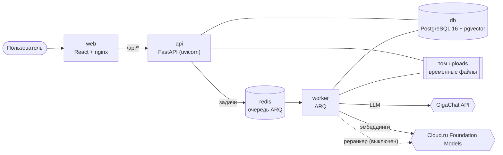
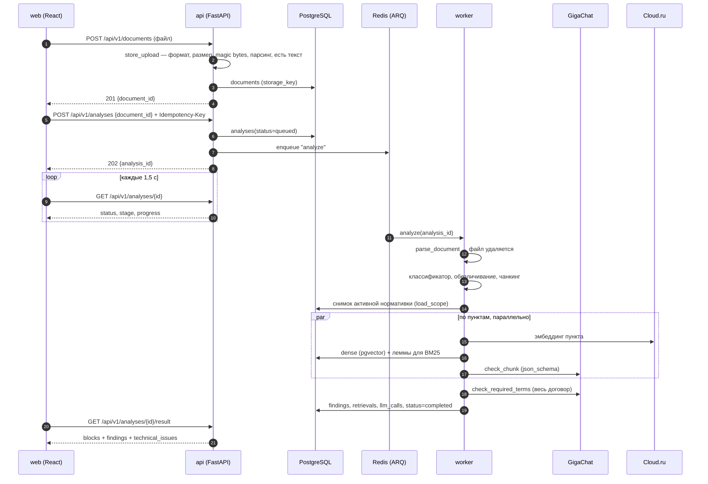
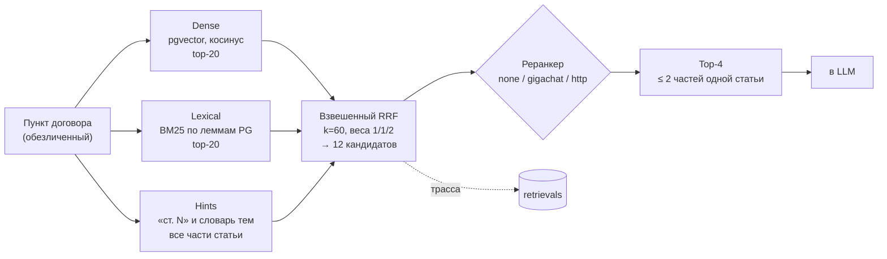
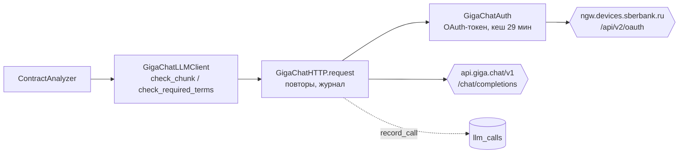
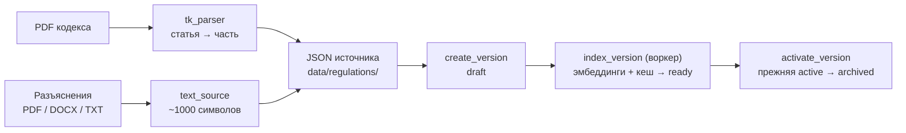
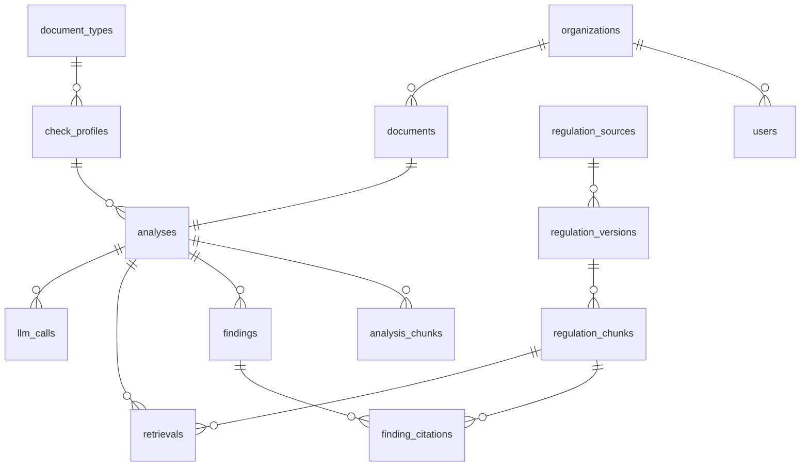

# Архитектура и пайплайны

Техническое описание: из чего состоит система, как по ней проходит запрос и где в коде лежит каждый шаг. Метрики и их методика — в [README](../README.md#первая-версия-модели-и-метрики), устройство поиска подробнее — в [RAG.md](RAG.md), контракты API и роли — в [CONTRACTS.md](CONTRACTS.md).

Состояние на 16.11.2026 (ветка `main`, коммит `4d44a25`). Пути к модулям backend в таблицах указаны относительно `backend/app/` (например, `analysis/service.py` → `backend/app/analysis/service.py`), запись `файл::функция` — функция или класс в этом файле.

## Содержание

1. [Компоненты](#1-компоненты)
2. [Пайплайн проверки документа](#2-пайплайн-проверки-документа)
3. [Пайплайн поиска норм (RAG)](#3-пайплайн-поиска-норм-rag)
4. [Слой LLM](#4-слой-llm)
5. [Валидация и сборка результата](#5-валидация-и-сборка-результата)
6. [Пайплайн нормативной базы](#6-пайплайн-нормативной-базы)
7. [Выдача результата и отчёты](#7-выдача-результата-и-отчёты)
8. [Авторизация и доступ](#8-авторизация-и-доступ)
9. [Данные](#9-данные)
10. [Оценка качества](#10-оценка-качества)
11. [Конфигурация](#11-конфигурация)
12. [Известные ограничения](#12-известные-ограничения)

---

## 1. Компоненты

| Сервис (`docker-compose.yml`) | Что делает | Точка входа |
|---|---|---|
| `web` | Статика React, прокси `/api`, `/docs` на `api` | `frontend/nginx.conf`, `frontend/src/App.tsx` |
| `api` | HTTP API: загрузка, запуск проверок, результаты, нормативка, пользователи. При старте: миграции → `seed` → `import-kb --if-empty` | `backend/docker/start-api.sh`, `backend/app/main.py` |
| `worker` | Проверка документа, индексация нормативки, «сторож» зависших задач | `backend/app/analysis/worker.py` (`WorkerSettings`) |
| `redis` | Очередь задач ARQ | — |
| `db` | Пользователи, проверки, замечания, нормативка с векторами, журналы | `backend/app/core/models.py`, `alembic/versions/0001_initial_schema.py` |

`api` и `worker` — **один образ** (`backend/Dockerfile`) в двух режимах запуска: модульный монолит. Модели не запускаются локально, все вызовы идут по API.

Слои кода `backend/app/`:

| Пакет | Ответственность | Зависит от |
|---|---|---|
| `domain/` | Чистая логика без ввода-вывода: модели данных, обезличивание, чанкер, правила, валидация | ничего |
| `documents/` | Приём файла, извлечение текста | `domain` |
| `knowledge/` | Нормативная база: импорт, индексация, поиск, BM25, реранкер | `domain`, `core`, `llm` |
| `llm/` | GigaChat (LLM и эмбеддинги), OpenAI-совместимый эмбеддер, заглушка, журнал вызовов | `domain` |
| `analysis/` | Оркестратор проверки, воркер, сохранение и чтение результатов | все выше |
| `auth/`, `audit/`, `reports/` | JWT и пароли, журнал действий, PDF/DOCX | `core` |
| `api/v1/` | Роутеры и DTO (`schemas.py`) | все выше |

---

## 2. Пайплайн проверки документа

### 2.1. Как ходит запрос

### 2.2. Шаги и где они в коде

| # | Шаг | Где | Что важно |
|---|---|---|---|
| 1 | Приём файла | `api/v1/documents.py` → `documents/upload.py::store_upload` | DOCX/PDF, ≤ `MAX_UPLOAD_MB`, проверка сигнатуры (`PK` / `%PDF`), пробный парсинг, отказ без текстового слоя. Коды ошибок: `unsupported_format`, `empty_file`, `file_too_large`, `corrupted_file`, `no_text_layer` |
| 2 | Создание проверки | `api/v1/analyses.py::start_analysis` → `analysis/service.py::create_analysis` → `analysis/queue.py::enqueue_analysis` | Права на документ, один документ — одна проверка, `Idempotency-Key` возвращает прежнюю проверку, привязка к активному профилю |
| 3 | Запуск в воркере | `analysis/worker.py::analyze` → `service.py::run_analysis` | Берёт только проверки в статусе `queued`; `attempt += 1`, `heartbeat_at` |
| 4 | Извлечение текста | `documents/parser.py::parse_document` | DOCX — абзацы и строки таблиц; PDF — строки страниц. Файл удаляется в `finally`: `storage_key = NULL`, `purged_at` (НФ-04) |
| 5 | Тип документа | `domain/classifier.py::is_supported_employment_contract` | Маркеры трудового договора и нумерация; иначе `failed / not_employment_contract` |
| 6 | Снимок нормативки | `knowledge/retrieval.py::HybridRetriever.load` → `load_scope` | Активные версии источников профиля на текущую дату; пусто → `knowledge_base_empty`. Снимок фиксируется на всю проверку |
| 7 | Обезличивание | `analysis/analyzer.py::anonymize_document` → `domain/anonymizer.py::anonymize_text` | Единственная точка, где сырой текст становится обезличенным; дальше только он |
| 8 | Чанкинг | `domain/chunker.py::chunk_document` | Пункт = блоки от строки «N.N» до следующей; длинные режутся с перекрытием; у пункта есть `block_ids` |
| 9 | Рамки профиля | `HybridRetriever.set_document_context` | Исключённые диапазоны статей открываются только по триггерам в тексте договора |
| 10 | Проверка полноты | `ContractAnalyzer._check_document_requirements` | Регекс-правила `domain/rules.py::check_required_terms`; если есть LLM — `check_required_terms` по ст. 57 и 100 (прямая выборка `find_by_article`); при сбое — откат на правила |
| 11 | Проверка пунктов | `ContractAnalyzer._check_chunk` | Правила → поиск → LLM → валидация (разделы 3–5). Параллельно, `asyncio.Semaphore(LLM_MAX_PARALLEL)` |
| 12 | Прогресс | callback `progress` в `run_analysis` | `chunks_done`, `progress`, `stage`, `heartbeat_at` после каждого пункта |
| 13 | Сохранение | `service.py::_persist` | `document_blocks`, `analysis_chunks`, `findings`, `finding_citations`, `retrievals`, `llm_calls`, `summary`, `is_partial`; статус `completed`. Если проверку уже отменили — ничего не пишется |

### 2.3. Ошибки и восстановление

| Ситуация | Поведение |
|---|---|
| Сбой LLM по одному пункту (сеть, 5xx, дважды невалидный JSON) | У пункта статус `error`, остальные пункты и правила работают, `is_partial = true` |
| Сбой проверки полноты | Технический сбой `document`, применяются регекс-правила |
| Битый файл, не договор, пустая база | `failed` с кодом и сообщением на русском |
| Неожиданное исключение | `failed / internal_error` |
| Воркер умер посреди проверки | Cron `watchdog` раз в минуту → `recover_stale`: `heartbeat` старше 5 мин → снова в очередь, если файл ещё не удалён и попыток меньше 3, иначе `failed / worker_lost` |
| Отмена пользователем | `DELETE /analyses/{id}` → `cancelled`; `_persist` результат не сохраняет |

---

## 3. Пайплайн поиска норм (RAG)

Код: `knowledge/retrieval.py::HybridRetriever.search`.

| Этап | Реализация |
|---|---|
| Эмбеддинг запроса | `OpenAICompatibleEmbedder` (Cloud.ru, Qwen3-Embedding-0.6B, 1024 изм.) через `CachedEmbedder`; к запросу добавляется инструкция (`EMBEDDING_QUERY_INSTRUCTION`), к нормам — нет |
| Dense (`_dense`) | `ORDER BY embedding <=> :vec LIMIT 20` по id фрагментов области поиска; сравниваются только векторы той же размерности |
| Lexical (`_lexical`) | Запрос лемматизируется в PostgreSQL (`to_tsvector('russian', …)`), ранжирует `knowledge/bm25.py::BM25Index` в памяти; индекс строится в `load()` из колонки `regulation_chunks.fts` |
| Hints (`_hints`) | `hinted_articles`: ссылки «ст. N» в тексте + `article_hints` из `check_profiles.params`; части каждой статьи сортируются по dense-близости, выдача — «по одной лучшей части каждой статьи, затем остальные» |
| Слияние | `rrf_fuse`, веса `channel_weights` (dense 1, lexical 1, hints 2) |
| Реранкер | `knowledge/rerank.py`: `NoReranker` (по умолчанию), `LLMListwiseReranker` (GigaChat, оценки 0–3), `HttpReranker` (`/rerank`, форматы TEI и Cohere). Ошибка реранкера → порядок RRF |
| Отбор | `top_k = 4`, `max_per_article = 2` |
| Рамки профиля | `excluded_article_ranges = [[251, 351.99]]` и `unlock_triggers` в `check_profiles.params` |
| Трасса | `RetrievedRegulation.trace` → таблица `retrievals` (rank, channels, vector/lexical/fused/rerank score) |

Ст. 57 и 100 в проверку полноты подаются **не поиском**, а прямой выборкой по номеру (`find_by_article`), как требует ТЗ (п. 5).

---

## 4. Слой LLM

| Что | Где | Поведение |
|---|---|---|
| Сборка клиентов | `llm/factory.py` (`build_llm_client`, `build_embedder`, `build_reranker`) | Провайдер из `.env`: `mock` / `gigachat` / `openai_compatible` |
| Авторизация | `llm/gigachat.py::GigaChatAuth` | Authorization key = base64(`client_id:client_secret`) (`Settings.gigachat_llm_key`); токен кешируется; TLS с сертификатом НУЦ (`certs/`) |
| Повторы | `GigaChatHTTP.request` | 401 → новый токен; 429 → экспоненциальная задержка с jitter, до 4 раз; тайм-аут и 5xx → 1 повтор (НФ-02) |
| Формат ответа | `GigaChatLLMClient._chat_content` | `response_format=json_schema` (strict). 400/422 → схема отключается; **пустой ответ при схеме → тот же запрос без схемы** |
| Невалидный JSON | `check_chunk` → `_parse_results` / `_repair_messages` | Один «ремонтный» запрос, затем `LLMResponseFormatError` → у пункта статус `error` |
| Промпты | `llm/client.py`: `SYSTEM_PROMPT`, `REQUIRED_TERMS_SYSTEM_PROMPT` | Только прямые противоречия с переданными нормами; метки `[PERSON]` и др. — скрытые данные, а не отсутствующие. Хеши промптов пишутся в `analyses.snapshot` |
| Журнал | `llm/calllog.py` (contextvar) → `_persist` | purpose, provider, model, attempt, latency, tokens, http_status, outcome. Тексты не хранятся |

---

## 5. Валидация и сборка результата

Каждый ответ LLM проходит через `domain/validation.py::validate_chunk_result`, затем через фильтры в `ContractAnalyzer._check_chunk`:

| Проверка | Если не прошла |
|---|---|
| Цитата договора дословно есть в пункте | → `not_applicable` |
| Цитата нормы дословно есть в поданных фрагментах; источник переопределяется по найденному фрагменту | → `not_applicable` |
| Предупреждения на уровне пункта (полноту проверяют на уровне договора) | → `not_applicable` |
| Комментарий сам отрицает нарушение или сводится к «условие не указано / не уточнено» | → `not_applicable` |
| Цитата договора состоит только из меток обезличивания | → `not_applicable` |
| Ту же фразу уже квалифицировало детерминированное правило | → `not_applicable` |

Затем:

| Шаг | Где |
|---|---|
| Дедупликация (правила добавляются первыми и «выигрывают») | `analyzer.py::_deduplicate_results`, плюс уникальный индекс `ux_findings_dedup` |
| Категория (Ф-07): нарушение → критическая; отсутствующее обязательное условие → критическая; неконкретная формулировка → рекомендательная | `analysis/postprocess.py::categorize` |
| Статья и заголовок замечания | `article_from_source`, `finding_title` |
| Поиск цитаты в абзацах для подсветки (`block_id`, `start`, `end`) | `postprocess.py::locate_quote` |
| Инвариант БД: нарушение без обеих цитат невозможно | `CHECK violation_has_quotes` в `findings` |

---

## 6. Пайплайн нормативной базы

| Шаг | Где | Детали |
|---|---|---|
| Разбор PDF кодекса | `knowledge/tk_parser.py` (`read_pdf_lines` → `merge_baselines` → `parse_code` → `to_source_json`), команда `python -m app.cli build-source` | PyMuPDF; абзац — по отступу первой строки, заголовки — по жирному шрифту; примечания справочной системы (отдельный цвет) и пометки «(в ред. …)» выбрасываются; нумерация частей учитывает утратившие силу; дата редакции — из преамбулы |
| Свободные документы | `knowledge/text_source.py::build_text_source` (`build-source --mode text`) | Абзацы → фрагменты ~1000 символов с перекрытием; `article` не заполняется |
| Создание версии | `knowledge/service.py::create_version` (API `POST /regulations` или `import-kb`) | Валидация формата, sha256 содержимого (дубликат → 409), части длиннее 1500 символов режутся по предложениям |
| Индексация | `service.py::index_version`, задача воркера `index_regulation_version` | Текст для эмбеддинга с заголовком «ТК РФ, ст. N «…», ч. M: …»; `CachedEmbedder` (таблица `embedding_cache`, ключ «модель + sha256»); статус `indexing → ready / failed` |
| Активация и откат | `service.py::activate_version` | Одна транзакция; уникальный индекс «одна активная версия на источник»; откат — активация архивной |
| Смена модели эмбеддингов | `python -m app.cli reindex` | Колонка `vector` без фиксированной размерности; поиск сравнивает только векторы той же размерности |

Сейчас активен полный ТК РФ в редакции от 31.07.2025: 525 статей, 1868 фрагментов (`data/regulations/tk_rf_2025-07-31.json`).

---

## 7. Выдача результата и отчёты

| Что | Где |
|---|---|
| Статус | `GET /analyses/{id}` → `analysis/results.py::status_out` |
| Результат: абзацы, замечания (критические первыми, затем по порядку в тексте), технические сбои, `is_partial`, дисклеймер | `GET /analyses/{id}/result` → `results.py::load_analysis_result` (409, если проверка не завершена) |
| История (свои; для `org_admin` — вся организация) | `GET /analyses` → `results.py::list_history` |
| Отчёт PDF (WeasyPrint) и DOCX (python-docx) | `GET /analyses/{id}/report?format=pdf\|docx` → `api/v1/reports.py` → `reports/export.py::render_report` |
| Интерфейс | `frontend/src/App.tsx`: подсветка строится по `findings[].highlights` поверх `blocks`; опрос статуса — `refetchInterval` 1,5 с |

---

## 8. Авторизация и доступ

| Что | Где |
|---|---|
| Вход, обновление и выход | `api/v1/auth.py` (`login`, `refresh`, `logout`), `auth/tokens.py` — JWT HS256 (access и refresh; refresh хранится хешем в `refresh_tokens`), `auth/passwords.py` — argon2 |
| Текущий пользователь и роли | `core/security.py`: `get_current_user`, `require_role`, `can_read_analysis` |
| Роли | `user` — свои проверки; `org_admin` — проверки и пользователи своей организации; `kb_expert` — нормативка; `service_admin` — всё |
| Режим разработки | `AUTH_DEV_MODE=true` — все запросы от имени сид-администратора |
| Аудит | `audit/service.py::log_event` → `audit_log` (без ПДн): вход и выход, загрузка документа, создание, отмена и удаление проверки, загрузка, активация и архивирование нормативки, создание и изменение пользователей и организаций |

---

## 9. Данные

| Группа | Таблицы | Особенности |
|---|---|---|
| Доступ | `organizations`, `users`, `refresh_tokens`, `audit_log` | email уникален без учёта регистра |
| Профили | `document_types`, `check_profiles`, `profile_sources`, `prompt_versions` | Параметры поиска и правил — `check_profiles.params` (JSONB). `prompt_versions` в схеме есть, но пока не используется |
| Нормативка | `regulation_sources`, `regulation_versions`, `regulation_chunks`, `embedding_cache` | `embedding vector` (pgvector), `fts tsvector` (вычисляемый, GIN-индекс) |
| Проверки | `documents`, `analyses`, `analysis_chunks`, `findings`, `finding_citations`, `retrievals`, `llm_calls` | В БД только обезличенный текст; `analyses.snapshot` — версии и параметры для воспроизводимости |
| Оценка | `eval_runs`, `eval_case_results` | История замеров с конфигурацией и коммитом |

Схема целиком — одна миграция `backend/alembic/versions/0001_initial_schema.py`, модели — `backend/app/core/models.py`.

---

## 10. Оценка качества

| Команда | Что меряет | Где |
|---|---|---|
| `python -m app.cli evaluate [--rules-only] [--case …]` | precision и recall замечаний на размеченных договорах (`evals/demo_cases.json`); совпадение = пункт + статья + статус | `evals/runner.py`, `evals/evaluation.py` |
| `python -m app.cli evaluate-retrieval [--rerank]` | recall@1/3/5, MRR по каналам поиска; recall@3* — без ст. 57 и 100 | `evals/retrieval.py` |

Результаты пишутся в `eval_runs`, отчёты по договорам — в `evals/results*/` (не в Git). Цифры последнего замера — в [README](../README.md#результаты-замера).

---

## 11. Конфигурация

Все параметры — в `.env` (шаблон `.env.example`), класс `backend/app/core/config.py::Settings`.

| Группа | Переменные |
|---|---|
| LLM | `LLM_PROVIDER` (`mock` / `gigachat` / `openai_compatible`), `LLM_MAX_PARALLEL` (freemium — 1), `GIGACHAT_CLIENT_ID`, `GIGACHAT_CLIENT_SECRET`, `GIGACHAT_LLM_MODEL` |
| Эмбеддинги | `EMBEDDING_PROVIDER` (`hashing` / `gigachat` / `openai_compatible`), `EMBEDDING_BASE_URL`, `EMBEDDING_API_KEY`, `EMBEDDING_MODEL`, `EMBEDDING_QUERY_INSTRUCTION` |
| Реранкер | `RERANKER` (`none` / `gigachat` / `http`), `RERANK_HTTP_URL`, `RERANK_HTTP_FORMAT`, `RERANK_HTTP_MODEL`, `RERANK_HTTP_API_KEY` |
| Поиск | `RETRIEVAL_CANDIDATES`, `RETRIEVAL_TOP_K`; остальное — в `check_profiles.params` (подсказки, веса, рамки профиля) |
| Доступ | `AUTH_DEV_MODE`, `JWT_SECRET`, `SEED_ADMIN_*` |

Без ключей система работает целиком: `mock` + `hashing` + `none` (так настроены и тесты, и CI).

---

## 12. Известные ограничения

- Точность замечаний LLM низкая (0,205 при цели 0,85); перезамер после исправления пустых ответов GigaChat не проводился.
- Реранкер выключен и не измерен.
- Обезличивание только на регулярных выражениях: не скрывает дату рождения, банковские реквизиты, имена без отчества.
- Нет OCR; проверяется один тип документа.
- Эмбеддинги разных моделей нельзя держать одновременно (смена модели → `reindex`).
- `prompt_versions` не используется: промпты в коде, в проверке сохраняются только их хеши.
- Нагрузочного тестирования не было.
